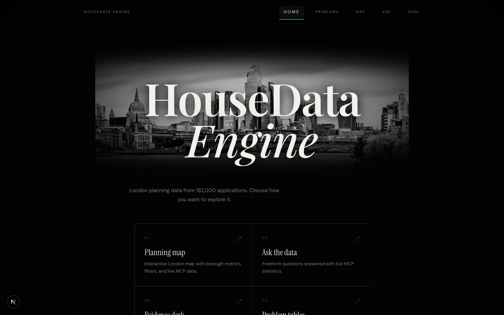
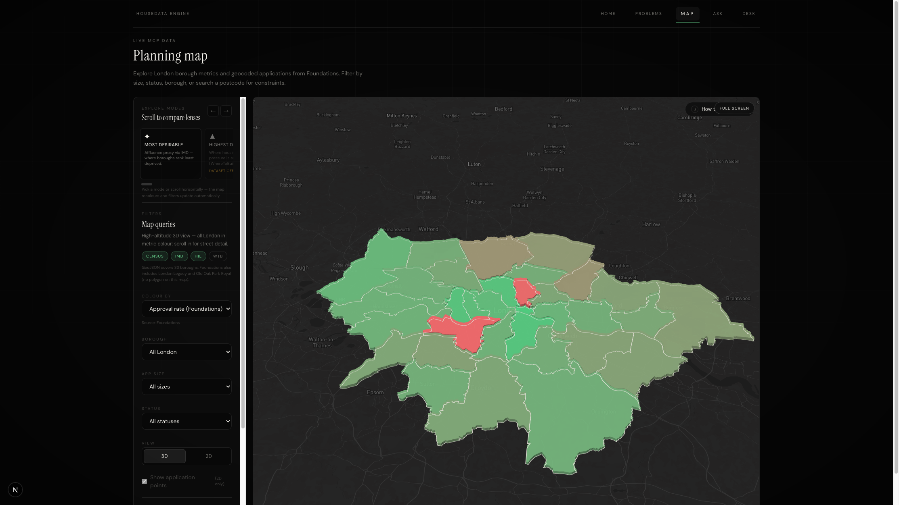
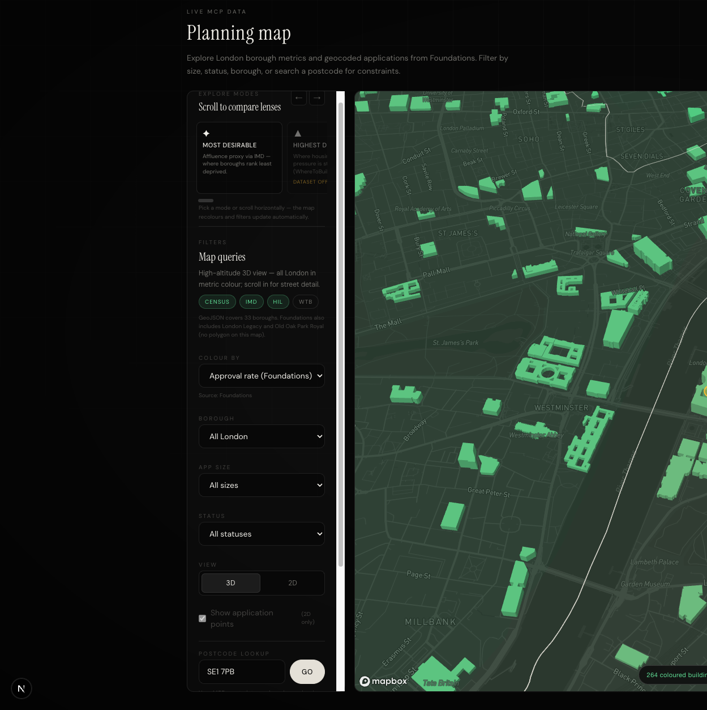
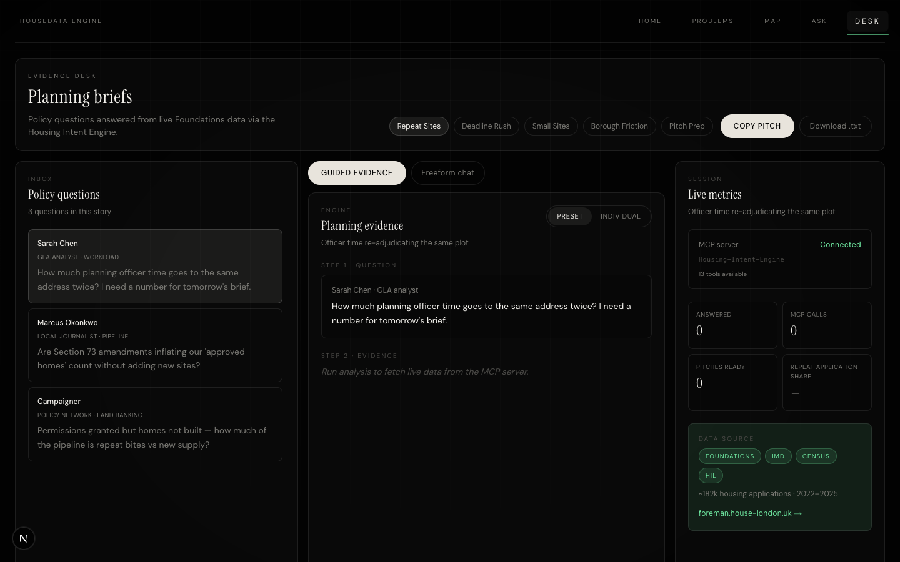
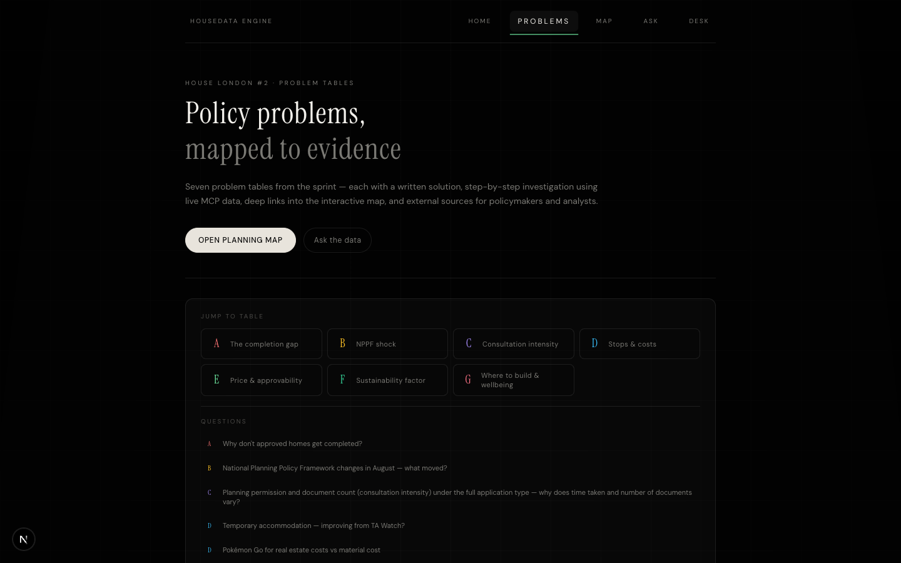

# HouseData Engine

**London planning analytics via MCP** — interactive map, evidence desk, and policy problem tables built on ~182,000 Foundations housing applications (2022–2025).

Built for the [House London](https://house-london.uk) hackathon.

---

## Screenshots

### Home



### 3D planning map — city view

Metric-coloured borough blocks at altitude; switch metrics, boroughs, and exploration modes from the sidebar.



Open: [`/map?view=3d`](http://localhost:3001/map?view=3d)

### 3D planning map — street level

Real Mapbox building footprints coloured by borough metric. Search a postcode (e.g. `SE1 7PB`) or zoom in — buildings load as you pan.



Open: [`/map?view=3d&postcode=SE1+7PB`](http://localhost:3001/map?view=3d&postcode=SE1+7PB)

### Evidence desk

Preset policy questions with live MCP evidence cards and pitch export.



### Problem tables

Seven sprint problem tables (A–G) with analysis, map deep links, and further reading.



---

## Features

| Page | URL | What it does |
|------|-----|--------------|
| **Planning map** | `/map` | 2D choropleth + **3D metric buildings** (Mapbox). Filter by borough, app size, status; postcode lookup; exploration modes. |
| **Ask the data** | `/chat` | Freeform questions answered with live MCP statistics. |
| **Evidence desk** | `/desk` | Preset hackathon cases (repeat sites, deadline rush, friction…) with evidence cards and pitch download. |
| **Problem tables** | `/problems` | Tables A–G — written solutions, investigation steps, map links. |

### 3D map layers

| Layer | When visible |
|-------|----------------|
| **Borough city-mass** | High-altitude 3D view — coloured extruded blocks for all London |
| **Native Mapbox buildings** | Zoom ≥ 11.5 — grey footprints until coloured cache fills in |
| **Coloured buildings** | Street level — real footprints tinted by active borough metric; accumulates as you pan |

---

## Quick start

### Prerequisites

- Python 3.11+
- Node.js 20+
- [Mapbox access token](https://account.mapbox.com/) (free tier is fine)

### 1. Clone and set up Python MCP server

```bash
git clone https://github.com/nayeeman49/house-london-mcp.git
cd house-london-mcp

python3.11 -m venv venv
source venv/bin/activate   # Windows: venv\Scripts\activate
pip install -r requirements.txt

mkdir -p data
curl -L "https://foreman.house-london.uk/download/parquet/" -o data/foundations.parquet

# IMD, Census 2021, Housing in London (~15 MB total)
python scripts/download_datasets.py
```

### Optional: WhereToBuild (hackathon only)

Not publicly downloadable. Ask House London organisers for `wheretobuild.parquet`:

```
data/wheretobuild.parquet
```

Event-only data — do not redistribute publicly.

### 2. Dashboard

```bash
cd web
cp .env.local.example .env.local
```

Edit `.env.local`:

```env
HOUSING_PROJECT_ROOT=/path/to/house-london-mcp
MCP_PYTHON=/path/to/house-london-mcp/venv/bin/python
MCP_SERVER=/path/to/house-london-mcp/src/server.py
NEXT_PUBLIC_MAPBOX_TOKEN=pk.your_mapbox_token_here
```

```bash
npm install
npm run dev
```

Open **http://localhost:3001**

| Route | Description |
|-------|-------------|
| http://localhost:3001 | Home |
| http://localhost:3001/map?view=3d | 3D planning map |
| http://localhost:3001/desk | Evidence desk |
| http://localhost:3001/problems | Problem tables |

---

## Project structure

```
house-london-mcp/
├── src/server.py              # MCP server (15 tools)
├── scripts/run_mcp_tool.py    # Python CLI bridge for the dashboard
├── data/foundations.parquet   # Download once (~24 MB)
├── docs/screenshots/          # README screenshots
├── web/                       # Next.js dashboard
│   ├── app/                   # Pages (map, desk, chat, problems)
│   ├── components/map/        # MapCanvas, PlanningMap, popups
│   └── lib/                   # MCP client, metrics, 3D buildings
└── .cursor/mcp.json           # Cursor MCP config
```

---

## MCP tools

| Tool | Data source |
|------|-------------|
| `list_data_sources` | Shows which local files are loaded |
| `get_repeat_application_burden` | Foundations |
| `get_deadline_bunching_by_borough` | Foundations |
| `get_small_site_approval_gap` | Foundations |
| `get_planning_friction_by_borough` | Foundations |
| `get_london_borough_map_metrics` | Foundations |
| `get_geocoded_applications` | Foundations |
| `get_wheretobuild_by_borough` | Warwick WhereToBuild (local parquet) |
| `get_wheretobuild_by_postcode` | WhereToBuild + postcodes.io |
| `get_census_stats_by_borough` | [Nomis Census 2021](https://www.nomisweb.co.uk/sources/census_2021) |
| `get_deprivation_by_borough` | [IMD 2025](https://deprivation.communities.gov.uk/) |
| `get_deprivation_by_postcode` | IMD + postcodes.io |
| `get_housing_in_london_by_borough` | [Housing in London](https://data.london.gov.uk/dataset/housing-london/) |
| `search_planning_constraints` | Planning Data API |
| `search_uk_planit_applications` | UK PlanIt |

### How MCP connects

The dashboard calls `/api/mcp` which:

1. Tries **MCP SDK** stdio transport → spawns `src/server.py`
2. Falls back to **Python bridge** → `scripts/run_mcp_tool.py`

Both hit the same tool functions.

---

## Cursor

Reload MCP in Settings. Config in `.cursor/mcp.json` and `~/.cursor/mcp.json`.

---

## Deploy publicly

See **[DEPLOY.md](./DEPLOY.md)** — Docker on **Railway** or **Render** (not Vercel-only).

Quick test:

```bash
docker build -t housedata-engine .
docker run -p 3000:3000 -e USE_MCP_ONLY=true -e NEXT_PUBLIC_MAPBOX_TOKEN=pk... housedata-engine
```

---

## Test Python tools

```bash
source venv/bin/activate
python -c "from src.server import get_repeat_application_burden; print(get_repeat_application_burden())"
```

---

## Licence & data

- **Foundations** planning data: [House London Foreman](https://foreman.house-london.uk/)
- **WhereToBuild**: event-only, not for public redistribution
- Code: see repository licence
